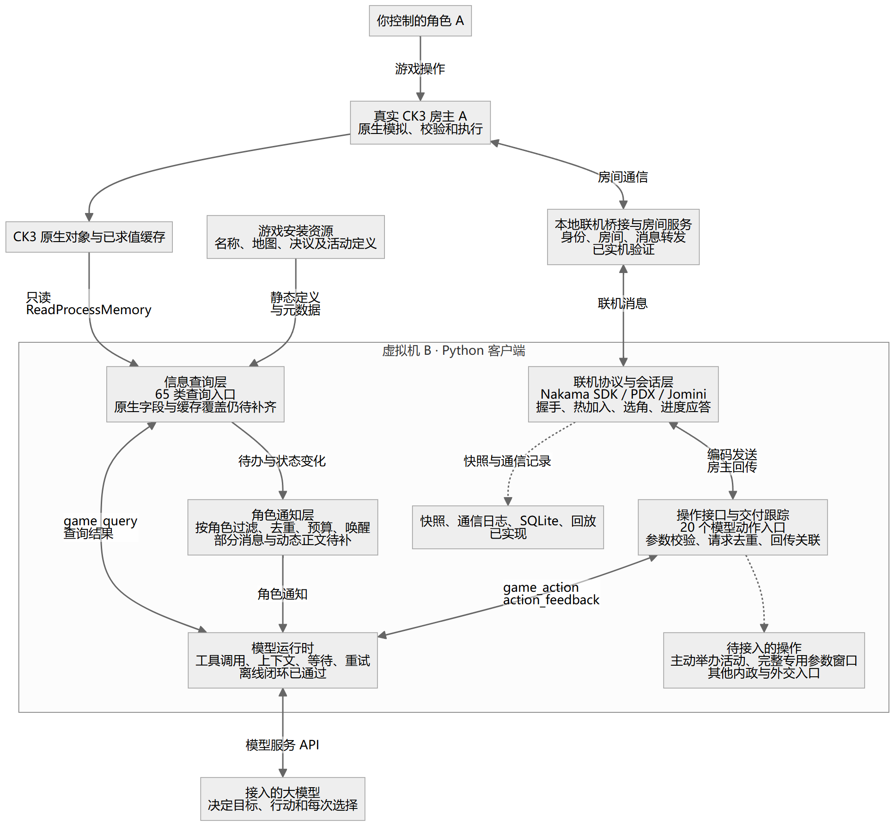
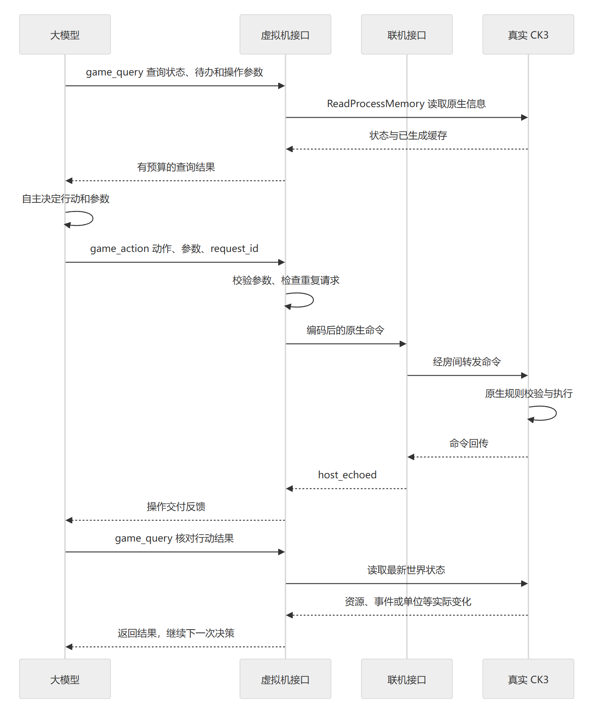

# 架构与完成状态

更新于 2026-11-20，适配 CK3 `1.20.1.2`。状态依据当前代码、实机验收报告（[docs/LIVE_VERIFICATION_REPORT.md](docs/LIVE_VERIFICATION_REPORT.md)）和项目交接，后续实现与验证完成后应同步更新本文及图源。

当前采用同机读取真实 CK3 房主内存的架构。

- 真实 CK3 负责世界推进、规则求值和行动效果结算。
- 虚拟客户端 B 负责联机、读取信息、通知和执行操作接口。
- 大模型负责所有玩法决策和具体选择。

## 整体架构

[SVG 图片](docs/architecture/architecture-overview.svg) · [Mermaid 源文件](docs/architecture/architecture-overview.mmd)

费用、条件和进度等业务结果优先读取原生字段或已求值缓存，未定位的结果返回未知。

## 大模型如何完成一次行动

[SVG 图片](docs/architecture/interaction-sequence.svg) · [Mermaid 源文件](docs/architecture/interaction-sequence.mmd)

`host_echoed` 表示收到房主回传，行动效果通过后续状态查询核对。模型推理和信息查询在后台运行，联机主循环继续收包与应答进度。模型也可调用 `wait_for_update` 等待通知。

## 已完成范围与缺口

“已实机验证”适用于表中列出的具体路径。

| 部分 | 已具备的能力 | 仍待完成 |
| --- | --- | --- |
| 联机底座 | 身份、建房、握手、热加入、选角、准备、正常退出与同身份重连已实机验证 | 长时间掉线恢复、长期同步与 OOS 验收 |
| 协议与交付 | 96 种原生命令编码，79 个模型动作入口，参数目录、请求去重、房主回传关联、状态查询 | 新增动作的逐项实机效果验收 |
| 模型运行时 | 查询、下令、等待、通知唤醒、上下文管理和失败重试，离线闭环通过 | 独立模型服务持续游玩的真实长局验收 |
| 世界信息读取 | 人物（含 `+0x68` 原生缓存年龄）、资源、领地、内阁任务、派系、阴谋、宫廷职位、骑士团、秘密、任务委托、战争、军队、战斗、围城、建筑，以及内阁任务类型/宫廷职位类型/宫廷任务/反制措施/法律/常备军兵种等静态目录查询；挂载 `ShadowEvaluator` 时可直接原生求值兵团/军队/佣兵总人数、移动段进度/锁定/ETA、围城进度与驻军上限、施工结束日期/剩余天数/百分比 | 战斗伤亡汇总、行军方向与跨省整段路线、围城每日速度预测（`projection`）及动态本地化正文等尚未定位的原生求值结果 |
| 事件与 NPC 窗口 | 普通事件选择曾实机生效，人物请求查询、正文缓存、显式回复与 400 种常规及头衔/宝物目标人物互动已接入 | 复杂动态正文、原生按钮状态、专用窗口及新增回复与互动实机验收 |
| 通知 | 角色过滤、去重、预算、筛选，军事、事件、人物请求和活动邀请等来源已接入 | 部分世界消息的角色归属、完整正文、日志和建议来源 |
| 决议 | 501 个安装决议的搜索、说明、条件与效果查询，原生冷却时间内存读取（`landed +0x430`），以及执行请求接口 | 当前可执行性、最终费用、专用参数窗口与实机执行验收 |
| 活动 | 23 类活动定义、原生冷却时间内存读取（`alive +0x500`）、当前实例、阶段与配置查询；`start_activity_command`（含 `CActivityPlan`/`CTravelPlan`）、`set_activity_intent_command`、参加（含可选旅行草案）、取消旅行与拒绝邀请接口 | 主动举办/设置意图/旅行草案的实机执行验收、活动专用窗口和原生参加资格 |
| 军事操作 | 集结、移动、停止、合并、半数分兵、强攻/停攻、常备军组建/增编/裁撤/补员、军队重组、分兵留守、附庸/脱离、劫掠、骑士状态、集结点增移删、雇佣/续约佣兵与骑士团等接口 | 宣战、指挥官及新增战术/常备军/集结点接口的完整实机验收 |
| 建设 | 开工、完工、已支付费用、候选建筑报价已实机验证 | 默认升级报价实机核对、完整合法性、缓存刷新标记和施工最终进度 |
| 其他玩法操作 | 重心、技能、内阁、阴谋与秘密、批量囚犯处置、宝物穿脱、法律与继承提名、摄政与职权、文化革新、宗族传承、头衔与首都、派系（含创建）、宫廷职位与任务、委托、463 种非宣战人物互动（含无工厂特化与授衔/剥夺/修改契约/内阁/宫廷职位/议和/选举/篡位派系/杂交文化等全部 `special_interaction` 载荷）已接入；`send_interaction` 已接入 `shadow_evaluator.py` 无注入写时复制 Unicorn 原生 `ai_accept`/`ai_intermediary_accept` 求值并禁止模型自填接受值 | 实机复杂脚本触发器树下的 `ShadowEvaluator` 兼容验收、互动动态费用及新增特化互动的逐项实机验收 |
| 记录与回放 | 原始包、通信日志、快照解析、SQLite 和离线回放已实现 | 长期历史查询与实时模型流程的进一步整合 |

最近一轮通过 378 项离线回归，96 种原生命令完成 1,552 次原生字节对照，内阁/派系/阴谋与宫廷职位/骑士团/秘密/任务委托原生读取分别完成 64 组 / 1,280 次及 64 组 / 2,112 次 Unicorn 对照，决议与活动冷却完成 256 组 / 2,048 次 Unicorn 原生函数对照。

## 实现位置

| 模块 | 实现 |
| --- | --- |
| 联机与协议 | `ck3_client.py`、`shadow_evaluator.py`、`nakama_native.py`、`pdx_nakama_codec.py`、`jomini_codec.py`、`session_codec.py`、`session_state.py` |
| 本地房间与启动桥接 | `local_nakama.py`、`local_game_bridge.py` |
| 内存与语义查询 | `process_memory.py`、`memory_world.py`、`live_objects.py` |
| 模型工具与交付反馈 | `model_runtime.py`、`game_actions.py`、`action_feedback.py` |
| 通知与筛选 | `game_notifications.py`、`notification_catalog.py`、`notification_policy.py` |
| 事件、请求与活动 | `event_catalog.py`、`pending_interactions.py`、`activity_invitations.py`、`planning_catalog.py`、`definition_catalog.py`、`interaction_catalog.py` |
| 建筑和原生消息缓存 | `building_economy.py`、`gui_message_feed.py` |
| 快照、历史与回放 | `transfer_protocol.py`、`snapshot_transfer.py`、`world_snapshot.py`、`world_store.py`、`ai_observation.py` |

运行方式、待办和实机证据见 [项目交接](PROJECT_HANDOFF.md)，接口示例见 [README](README.md)，原生布局与协议研究见 [协议调查](PROTOCOL_FINDINGS.md)。
